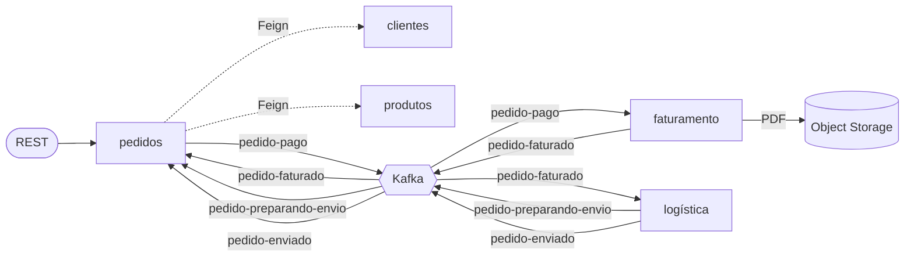
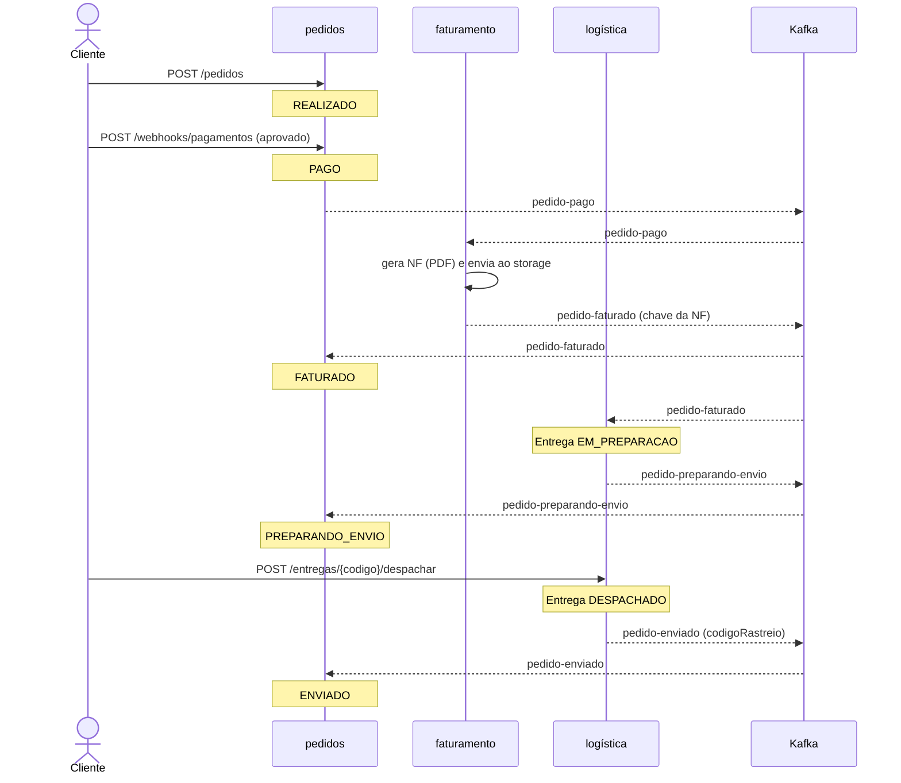
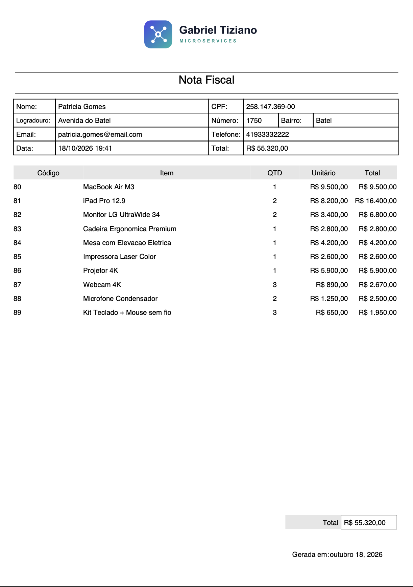
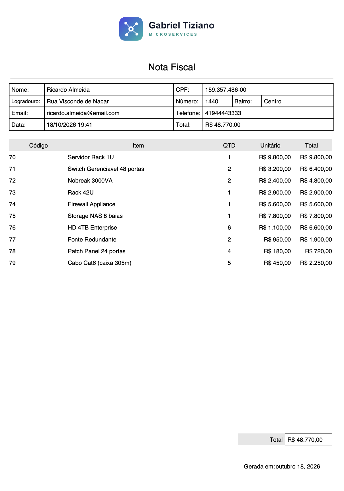

# Order Management Microservices

Sistema de gestão de pedidos construído como um conjunto de microsserviços orientados a eventos, usando **coreografia sobre Apache Kafka** — sem orquestrador central. Cada etapa do ciclo de vida de um pedido (pagamento, faturamento, preparação e envio) é um serviço independente, dono do próprio banco, que reage a eventos e publica os seus.

A proposta não é um CRUD distribuído. É exercitar, num cenário realista de e-commerce, as decisões difíceis de um sistema distribuído de verdade: consistência sem transação global, idempotência, tolerância a mensagens corrompidas, versionamento de contrato entre serviços e como se testa um fluxo que atravessa cinco processos.


## Arquitetura



Cinco serviços, cada um com o seu PostgreSQL e a sua responsabilidade:

| Serviço | Porta | Banco | Responsabilidade |
| --- | --- | --- | --- |
| clientes | 8082 | `ms_clientes` | Cadastro de clientes |
| pedidos | 8083 | `ms_pedidos` | Dono do ciclo de vida do pedido (FSM); ponto de entrada do fluxo |
| produtos | 8084 | `ms_produtos` | Catálogo e estoque |
| faturamento | 8085 | `ms_faturamento` | Emissão da nota fiscal (PDF) e publicação do faturamento |
| logística | 8086 | `ms_logistica` | Entrega: preparação e despacho |

O único acoplamento síncrono do fluxo é a criação do pedido, que consulta clientes e produtos via OpenFeign para montar um snapshot imutável. Depois disso, tudo acontece por eventos.

## O ciclo de um pedido

Um pedido nasce em `REALIZADO` e percorre uma máquina de estados até `ENVIADO`. Cada transição é disparada por um evento consumido de outro serviço — com uma exceção proposital: o despacho é um comando REST explícito, porque quem decide quando a carga sai é um operador, não um evento.



A transição `REALIZADO -> PAGO -> FATURADO -> PREPARANDO_ENVIO -> ENVIADO` tem um desvio: um pagamento recusado leva o pedido a `ERRO_PAGAMENTO`, de onde ele pode voltar a `REALIZADO` numa nova tentativa. Toda transição passa por um validador — um evento fora de ordem é rejeitado, não aplicado silenciosamente.

Vale olhar o `pedido-faturado`: ele é consumido por **dois** serviços ao mesmo tempo (fan-out). Pedidos usa para avançar o status; logística usa para abrir a entrega. Como cada um está num consumer group diferente, os dois recebem toda mensagem.

## Decisões de arquitetura

A parte interessante do projeto está aqui. Cada escolha abaixo foi feita de propósito e tem um porquê.

### Coreografia, não orquestração

Não existe um serviço "maestro" que conhece o fluxo inteiro. Cada serviço sabe apenas a que evento reage e qual evento publica. Isso mantém os serviços desacoplados e o fluxo fácil de estender — acrescentar um novo passo é escrever um novo consumidor, sem tocar nos existentes. O custo é que o fluxo completo não está escrito em lugar nenhum; ele emerge da soma das reações. O diagrama de sequência acima existe justamente para documentar esse comportamento emergente.

### Database-per-service e snapshot de dados

Cada serviço é dono exclusivo do seu schema; ninguém lê o banco do vizinho. Quando o pedido precisa de dados de cliente e produto, ele os copia para dentro de si no momento da criação (snapshot), via OpenFeign. A partir daí, uma mudança de preço ou de endereço não reescreve pedidos antigos — o pedido guarda o estado que valia quando foi feito.

### Event-Carried State Transfer e Tolerant Reader

Os eventos carregam o estado que o consumidor precisa, em vez de só avisar "algo mudou, vá buscar". O `pedido-faturado`, por exemplo, leva a chave da nota; o `pedido-enviado` leva o código de rastreio. Assim o consumidor não precisa fazer uma chamada de volta ao produtor.

Do outro lado, cada serviço define a sua própria representação do evento, com apenas os campos que usa — o padrão Tolerant Reader. Os consumidores ignoram o cabeçalho de tipo do produtor (`spring.json.use.type.headers: false`) e desserializam contra a classe local. Resultado: o produtor pode adicionar campos, ou renomear o seu pacote, sem quebrar quem consome.

### Idempotência em duas camadas

Kafka entrega ao menos uma vez — reprocessamento acontece. Cada consumidor trata isso em duas frentes. Na aplicação, checa se já processou aquele pedido antes de agir (e, no caso da máquina de estados, um evento repetido cai no estado em que o pedido já está e é ignorado). No banco, uma constraint de unicidade em `codigo_pedido` é a última linha de defesa contra a corrida entre duas entregas da mesma mensagem — a verificação na aplicação resolve o caso comum, a constraint resolve o caso concorrente.

### Claim Check para a nota fiscal

A nota fiscal é um PDF; mandar bytes de arquivo pelo Kafka é um antipadrão. O faturamento gera o PDF, envia para o armazenamento de objetos e publica no evento apenas a **chave** do arquivo. Quem precisar da nota a busca no storage pela chave. O tópico fica leve e o broker não vira repositório de binário.

### Resiliência no consumo

Dois mecanismos distintos, que costumam ser confundidos. O `ErrorHandlingDeserializer` protege contra a mensagem corrompida (poison pill): sem ele, um erro de desserialização acontece antes do tratador de erro conseguir avançar o offset, e o consumidor entra em laço infinito relendo a mesma mensagem. Já o `DefaultErrorHandler` cuida de exceções lançadas pelo listener (regra de negócio, banco fora do ar): tenta de novo algumas vezes e, esgotadas as tentativas, segue em frente em vez de travar a partição.

### Um consumidor, vários tipos de evento

O serviço de pedidos escuta três tópicos diferentes, cada um com um payload diferente. Um `JsonDeserializer` com tipo fixo não serve nesse caso — ele é único e desserializaria tudo para o mesmo tipo. A solução foi usar um deserializer cru (`ByteArrayDeserializer`) e um `RecordMessageConverter`, que infere o tipo a partir da assinatura de cada `@KafkaListener`. Com a precedência de tipo em `INFERRED`, o tipo do método vence o cabeçalho do produtor, o que fecha bem com o Tolerant Reader descrito acima.

### Consistência e o dual-write

Persistir no banco e publicar no Kafka são duas operações sem transação comum. O projeto adota a ordem segura — publica depois do commit do banco, nunca antes — para não anunciar um estado que pode não ter sido salvo. A solução completa para esse problema (Transactional Outbox) está no roadmap; a decisão consciente de onde publicar já evita a falha mais grave.

## Estratégia de testes

O projeto é testado em três camadas, cada uma provando uma coisa diferente — e cada uma pegando o que a de baixo não pega.

**Unitários (JUnit + Mockito).** Regras de domínio e a máquina de estados, com as dependências mockadas. Rápidos, rodam a cada build.

**Integração com Kafka embarcado (`@EmbeddedKafka`).** Sobem o contexto real do serviço com um broker em memória, publicam eventos de verdade e verificam o pedido mudando de estado no banco. Exercitam a fiação que o mock não vê: desserialização, o message converter, o roteamento do `@KafkaListener`, o serviço e o repositório. Também há testes de repositório com Testcontainers, que validam entidade contra o schema real do Postgres.

**End-to-end caixa-preta (Playwright, modo API).** Com a stack inteira no ar, um processo externo cria cliente, produto e pedido, aprova o pagamento e acompanha o pedido percorrer `REALIZADO -> ENVIADO` atravessando os cinco serviços e o Kafka real — sem nenhum mock. É o único teste que prova que o sistema todo funciona junto.

Essa separação é proposital: o teste de integração sobe em segundos no CI e trava regressão de configuração; o E2E precisa de ambiente, mas é o que garante que os contratos entre serviços realmente se encaixam.

## Stack

- **Java 21**, **Spring Boot 4.1.1**, **Spring for Apache Kafka**
- **PostgreSQL** com **Flyway** (migrações versionadas, um banco por serviço)
- **OpenFeign** para a comunicação síncrona pontual (pedidos -> clientes/produtos)
- **JasperReports** para o PDF da nota fiscal
- Armazenamento de objetos compatível com **S3** para as notas
- **Docker** para a infraestrutura local (Postgres, Kafka, storage)
- **GitHub Actions** para CI por serviço
- **Playwright** para o teste end-to-end

## Rodando localmente

Pré-requisitos: Docker, JDK 21 e Node 18+.

```bash
# sobe infra (Postgres, Kafka, storage) + os 5 serviços e espera ficar pronto
bash scripts/dev-up.sh

# em outro terminal: o teste end-to-end do ciclo completo
cd e2e
PLAYWRIGHT_SKIP_BROWSER_DOWNLOAD=1 npm install
npm test

# ao final
bash scripts/dev-down.sh --infra
```

O `dev-up.sh` sobe os três compose de `servicos/`, inicia os cinco serviços com o JDK 21 e só retorna quando todos respondem (logs em `scripts/logs/`).

## Exemplo de saída

A nota fiscal é gerada em PDF a cada faturamento e enviada ao storage. Dois exemplos reais produzidos pelo fluxo:




## Roadmap

- **Transactional Outbox** para eliminar de vez o dual-write entre banco e broker.
- **Dead-Letter Topic** para isolar mensagens que esgotaram as tentativas, em vez de apenas descartá-las.
- Ampliar a suíte end-to-end automatizada no CI, com a stack subindo em containers.
